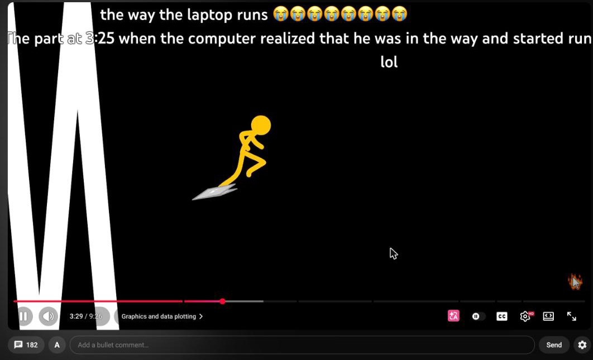
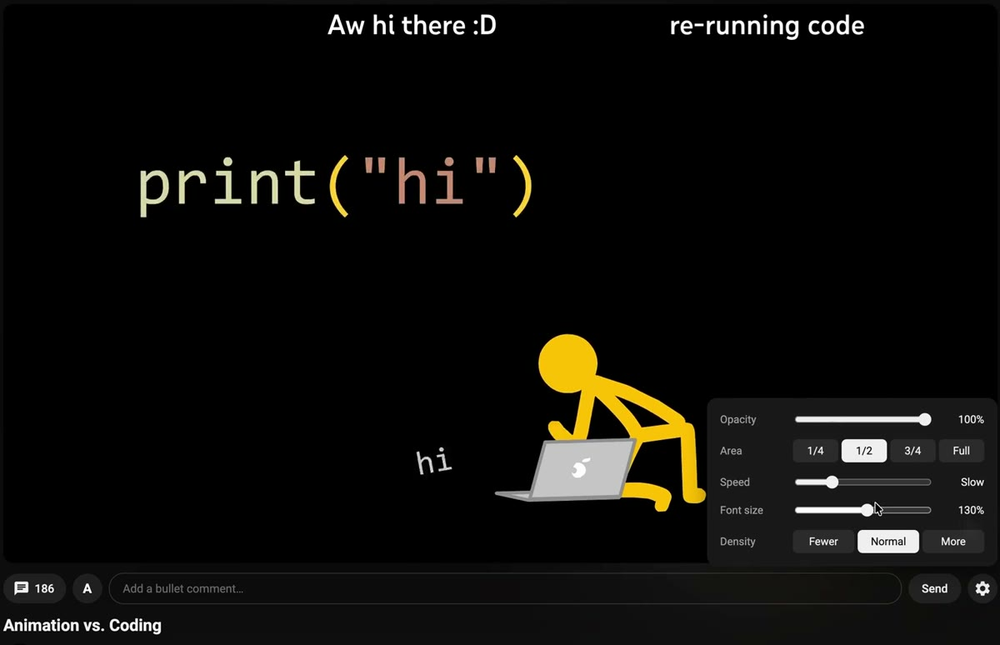
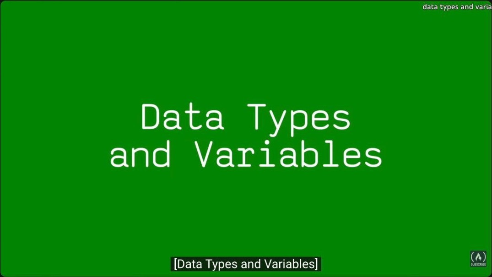
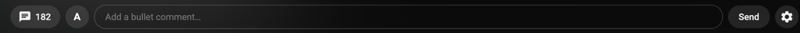
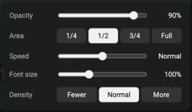
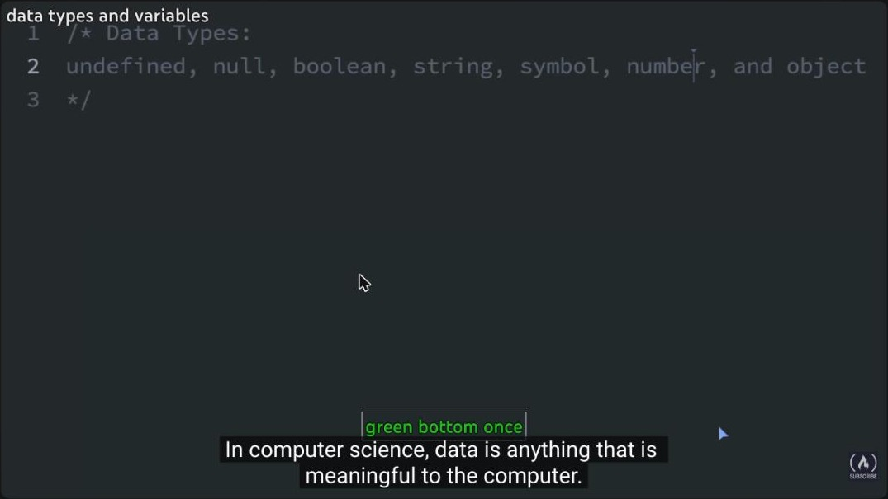

# Midterm: Bullet Comments for YouTube

A Chrome extension that adds bullet comments (danmaku, 弹幕) to YouTube: comments that fly across the
video at the exact second they were written.

- Idea presentation (Week 6): [Kia Bai - Web Tools Midterm Idea](https://docs.google.com/presentation/d/14B4YIsfiu5nRQ12l6akN2wWIW0IR-ISXPo81UllQrxc)

## Demo video

[Watch the demo (1 min, mp4)](demo.mp4)

## Who

Me. I learn a lot from YouTube coding tutorials, and before that I learned the same way on Bilibili.

## Why

On Bilibili, tutorials are full of bullet comments. They keep you company, and more importantly people
point out mistakes and add missing information right where it matters ("p5.js 2.0 removed
`preload()`"). YouTube has none of this. When I checked in October, a Bilibili JavaScript course had
29.1 bullet comments per 1,000 views; freeCodeCamp's JavaScript course on YouTube had 0.42 comments per
1,000 views, and those comments sit below the video, away from the moment they talk about.

## What it does

1. **Send a comment at this moment.** Type under the player and press Enter. The comment is pinned to
   the current second and flies across for everyone who watches that second later, and live for anyone
   watching right now.
2. **Timestamped YouTube comments become bullet comments.** A comment like "5:58 data types and
   variables" flies at 5:58. This was my answer to the feedback that a platform needs a user base
   before it is useful: every video already has comments on the first day. A comment that is a list of
   chapters becomes one bullet comment per line.

3. **Bilibili-style controls.** Turn comments on and off (the button shows how many there are), pick a
   colour and Scroll / Top / Bottom for your own comments, and change opacity, display area, speed, font
   size and density for what you see. In fullscreen the input bar floats above YouTube's controls.

Comments pause, seek and change speed with the video, hide during ads, and long comments scroll instead of
being cut off.

## How it works

- A Chrome extension (Manifest V3) built with WXT and TypeScript. One content script runs on YouTube
  watch pages.
- Comments people send are stored in Firebase Firestore with the video id and the second they belong
  to. A live listener means a comment sent on one laptop appears on another right away.
- Timestamped YouTube comments come from the YouTube Data API. They are fetched for each viewer and
  never stored, because YouTube's API policy limits how long that data can be kept.
- Every frame the extension reads the video's current time and sends out the comments whose second has
  just passed. Each comment is an HTML element animated with the Web Animations API, so pausing the
  video or changing its speed applies to the animation directly.
- The parts with logic (reading timestamps out of comments, the timeline, choosing a lane so comments
  don't overlap) have unit tests.

## What I learned from building it

- The cold start problem is real. Without the YouTube comments, every video I opened was empty, and an
  empty bullet comment tool feels broken rather than quiet.
- Tutorials with many short remarks ("at 1:06 my purple is different from yours") feel the most like
  Bilibili. Long courses mostly have chapter lists, which read more like subtitles than conversation.
- YouTube is a single-page app, so the extension has to notice when you move to another video without a
  page load, and ads play in the same video element as the video itself.

## Next

- Moderation (reporting, hiding spam) before more people use it.
- A way to vote a correction up so it stands out from chatter.
- Publishing to the Chrome Web Store, which needs a privacy policy and a review.

## AI use

I built this with Claude Code (Anthropic, model Claude Opus 5.5) on October 26, 2026.

**Prompt** (my requests during the session, translated from Chinese and condensed):

> Build a Chrome extension for my Web Tools midterm, which is due tomorrow: Bilibili-style bullet
> comments on YouTube, for people learning from coding tutorials. It has two features. First, I type a
> comment and it is pinned to the current second of the video and flies across for everyone who watches
> that second. Second, YouTube comments that contain a timestamp like "5:58" fly at that second too, so
> a video isn't empty on the first day. Use Firebase to store comments and the YouTube Data API to read
> comments. Use the tools and practices that are standard in the industry, not only what we covered in
> class. Also research GitHub projects and articles on how danmaku work. Then add Bilibili's controls:
> font size, speed, density, display area, top and bottom comments, and colour. Don't store YouTube
> comments; store only what people send through the extension. The interface is for an English-speaking
> audience, so no Chinese text.

**How I used it.** I decided what the tool is for and what it does: the two features, Firebase, not
storing YouTube comments, which settings to copy from Bilibili, which demo videos to use, and every
interface change, which I asked for by sending screenshots of the running extension (the icon is too
big, the number should sit next to the icon, no timestamp in the placeholder, say "bullet comment"
instead of "danmu"). Claude Code wrote the design document, the plan, the code and the unit tests, set up
the Firebase project, searched for related projects such as weizhenye/Danmaku and Danmaku Anywhere, ran
a separate AI code review, and checked each change in my browser before I looked at it. I used AI here
because the point of this midterm for me was to design the tool and watch people use it, and it let me
get to a version people can actually try. I kept the full chat log and can share it.
